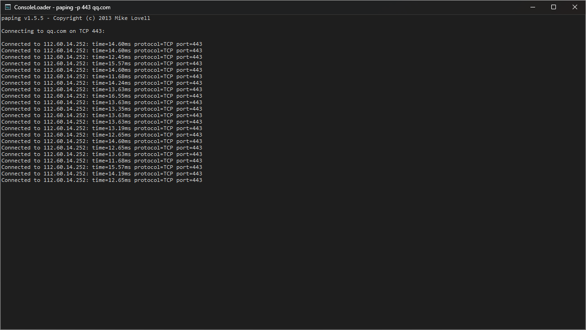

# ConsoleLoader

Lightweight native Win32 GUI wrapper for Windows console applications and batch scripts. Runs the command in the background, displays stdout/stderr, and highlights common Windows command status messages.



## Run

```text
ConsoleLoader.exe "D:\Scripts\Start.cmd"
ConsoleLoader.exe "D:\Scripts\Start.cmd" 430x220
ConsoleLoader.exe "C:\Windows\System32\ping.exe" 8.8.8.8 -t 640x360
ConsoleLoader.exe "E:\PotPlayer+\Tools\mediainfo\mediainfo.exe" 650x400 "D:\Videos\example.mp4"
```

- Optional `WIDTHxHEIGHT`: outer window size in pixels, from 320x160 through 8192x8192. Place it **last** (original syntax) or **immediately after the target executable** (for Windows Explorer **Send to** shortcuts that append selected file paths). Other arguments are passed through unchanged.
- Without the size parameter, the window uses the original 1280x720 default.
- **Send to setup:** press Win+R, run `shell:sendto`, and create a shortcut whose **Target** is `"D:\BaiduSync\Public\CMD\ConsoleLoader.exe" "E:\PotPlayer+\Tools\mediainfo\mediainfo.exe" 650x400`. Explorer automatically appends the selected video file path(s); no intermediary `.cmd` and no console flash.
- Resize a window by dragging its borders, right-click the **title bar**, select **复制窗口尺寸: WIDTHxHEIGHT**, then paste that dimension into the shortcut target.
- **Auto-copy text:** right-click the title bar and check **选中后自动复制** (off by default). Selecting text with the mouse and releasing the button copies the selection as plain Unicode text; completing Shift-selection or Ctrl+A also copies it. Unchecking the option restores normal behavior.
- **Font and font size:** title bar right-click > **字体与字号...** opens the native Windows font dialog. Changes take effect in the currently displayed report and future output without discarding existing colored highlights.
- Both settings persist per Windows user under `HKEY_CURRENT_USER\\Software\\rampageX\\ConsoleLoader` (`AutoCopy`, `FontName`, `FontSize`, `FontWeight`, `FontItalic`); no extra INI/config files or administrator rights needed. Default font is Consolas 9pt.
- Closing ConsoleLoader stops its directly launched process. Applications launched independently by a script (for example `start "" "C:\Program Files (x86)\Proxifier\Proxifier.exe"`) are not killed.
- stdout/stderr output is decoded as UTF-8 when valid, otherwise with the system OEM code page. Windows status lines and numerical latency values are colored.
- The scroll bar is custom-painted to match Windows light/dark mode.

## Build (MSYS2 UCRT64)

```sh
windres ConsoleLoader.rc -O coff -o ConsoleLoader_res.o
g++ -std=c++17 -O2 -pipe -municode -mwindows ConsoleLoader.cpp ConsoleLoader_res.o -o ConsoleLoader.exe -static-libstdc++ -static-libgcc -lole32 -luuid -lcomctl32 -ldwmapi -lgdi32 -lshell32 -lcomdlg32
```

Windows x64 builds run in GitHub Actions on `master` and the test branch. Test executables are available as Actions artifacts; official versioned binaries are published in [Releases](https://github.com/rampageX/ConsoleLoader/releases).

## Compatibility

Use `"path\to\script.cmd" WIDTHxHEIGHT` when launching a batch script. Exact behavior of command-line special characters in batch arguments follows `cmd.exe /D /S /C` rules.
